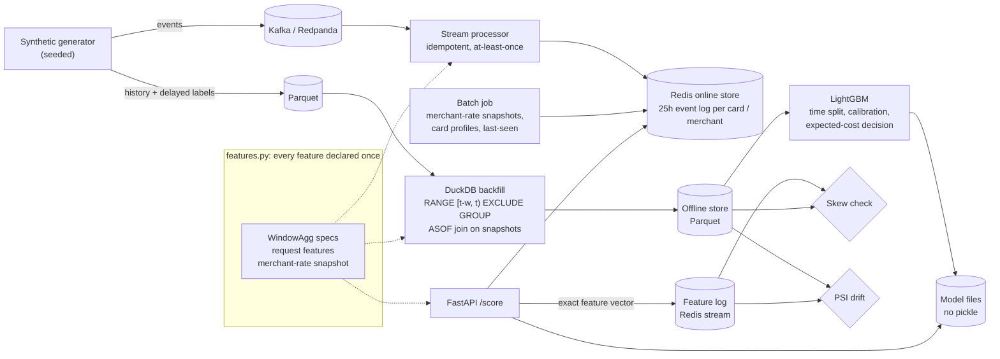

# fraud-feature-pipeline

An end-to-end fraud-detection pipeline on **fully synthetic** card transactions. Features are declared once and computed two ways: by a Kafka → Redis stream processor for serving, and by a point-in-time-correct DuckDB backfill over Parquet for training. A LightGBM model is trained on the offline features and served by a FastAPI endpoint that reads the online ones. A skew check then compares the two paths value by value, and a PSI report watches for drift.

The ML in this repo is deliberately ordinary. The work is in the plumbing around it, where production ML systems usually go wrong.

## The problem

Two failures show up again and again in production ML, and fraud models are especially exposed to both:

- **Train/serve skew.** The model is trained on features computed one way (a batch job) and served features computed another way (a streaming job or a request handler). The two drift apart through time-zone bugs, off-by-one windows, a cache that wasn't warmed, or a consumer that lags. The model is then scoring inputs it never saw in training. Google's [Rules of Machine Learning](https://developers.google.com/machine-learning/guides/rules-of-ml) devote a section to this. Rule #29 says to log the features used at serving time and compare them with training, Rule #32 says to reuse code between the two pipelines, and Rule #37 says to measure skew explicitly.
- **Leakage through time.** A training row uses information that wasn't available when the decision was made. Fraud labels are chargebacks that arrive days or weeks later, so any feature built from labels (for example "this merchant's fraud rate") leaks if it's joined on the event time instead of the time the label arrived. Feast's docs on [point-in-time joins](https://docs.feast.dev/getting-started/concepts/point-in-time-joins) describe the same issue and the `created_timestamp` filter it needs.

This repo builds both paths, measures the gap between them, and shows with real numbers what happens when you get it wrong.

## Architecture



**Window contract.** Both engines must agree on this. For an event at time `t`, a window feature aggregates the same entity's events with `t − window ≤ ts < t`. The event itself, and anything at exactly `t`, is excluded. Offline, this is a DuckDB `RANGE BETWEEN w PRECEDING AND CURRENT ROW EXCLUDE GROUP` frame generated from the spec. Online, it's a Python evaluation of the same spec over a Redis sorted set.

## Results (synthetic data, seed 7)

All numbers below come from `ffp demo --redis-url …` followed by `scripts/bench_api.py` on an 8-vCPU Linux box, using the default dataset: **641,118 transactions over 150 days, 3,000 cards, 500 merchants, 3,024 fraudulent (0.47%)**, of which 2,779 were eventually reported. The raw output is in [`reports/`](reports/). The data is synthetic, so these numbers say the pipeline works. They say nothing about how a fraud model would perform on real traffic.

### Model (held-out days 130–150: 85,188 transactions, 406 reported frauds)

| metric | value |
|---|---|
| PR-AUC (primary) | **0.593** (95% bootstrap CI 0.544–0.639) |
| ROC-AUC | 0.967 |
| Brier score / ECE | 0.00276 / 0.0016 |
| Calibration chosen | none (Brier on a later window: none 0.00277, Platt 0.00287) |

| decision policy | blocked | precision | recall | total cost* |
|---|---:|---:|---:|---:|
| approve everything | 0 | – | 0% | $140,392 |
| hand-written rules | 663 | 15.7% | 25.6% | $111,226 |
| model, single cost-optimal threshold | 3,095 | 10.2% | 78.1% | $35,594 |
| **model, expected-cost rule (amount-aware)** | **2,005** | **15.0%** | **74.1%** | **$33,402** |

\*Cost = missed fraud amount + $15 handling per missed fraud + $5 friction per blocked good transaction. The expected-cost rule blocks when `p × (amount + 15) > (1 − p) × 5`, so a 2% risk blocks a $1,000 purchase but not a $10 one.

Recall by pattern (expected-cost rule; ground truth includes unreported fraud): card testing **97%**, account takeover **93%**, merchant ring **22%**. The ring is a merchant compromised 15 days before the end of the data. Its chargebacks haven't arrived yet, so the label-derived merchant rate can't see it. That's the honest cost of not leaking.

### Leakage: what the wrong pipeline would have reported

The leaky variant computes the merchant fraud rate by **event time** (join labels on `txn_id`, then roll up), which is the natural first thing to write. It only counts earlier events, so it looks point-in-time correct. But it uses chargebacks that hadn't arrived yet.

| | PR-AUC | merchant-ring recall |
|---|---:|---:|
| correct pipeline | 0.593 | 22% |
| leaky pipeline, **offline estimate** | **0.770** | **88%** |
| same leaky model, **as served** (online features are point in time by construction) | 0.609 | 1.5% |

The offline estimate overstates the real model by 0.16 PR-AUC, and the ring detection it promises vanishes in production. `tests/test_point_in_time.py` is what prevents this. It changes every event and label after a cutoff and asserts that features before the cutoff stay identical.

### Train/serve skew, measured

The demo replays day 140 (3,958 events) through the online path: score from Redis, log the feature vector, then let the stream processor apply the event. The skew check then recomputes every served event offline and compares all 21 features.

| scenario | result |
|---|---|
| processor in sync | **0 mismatches** across 21 features × 3,958 events |
| store started without bootstrapping "last seen" | `card_seconds_since_last_txn` wrong on 493 events (12.5%) |
| processor lagging 50 events behind the scorer | 15 features skewed, e.g. `merchant_txn_count_1h` on 1,843 events (46.6%), `card_txn_count_1h` on 140 (3.5%) |

The second row is a real bug that this check caught on the first end-to-end run, not a staged one. A freshly started store had no last-seen time for cards idle for more than 25 hours. The fix is `OnlineStore.load_card_last_seen`. The same flow through real Kafka and the HTTP API (`ffp replay` + `ffp monitor`, and the compose CI job) also reports 0 mismatches. At full replay speed, which compresses 6 hours into about 2 seconds, it reports lag skew, as it should.

### Drift (PSI)

From [`reports/drift.md`](reports/drift.md), training reference vs. the last 7 days:

- `is_foreign` **0.23** (moderate): the synthetic holiday season moves shoppers to foreign online stores.
- `merchant_fraud_rate_30d` **0.17** (moderate): the new ring, plus labels that haven't arrived yet.
- `amount` only **0.04**, even though holiday amounts are up 35%. Amounts span three orders of magnitude across categories, so a uniform 35% shift barely moves the quantile bins. A per-category amount check would catch it, and a single global PSI won't.
- On one replayed day, the daily-snapshot merchant rate shows PSI 0.81. A single day holds one snapshot value per merchant, which concentrates mass into a few bins. Compare weekly windows for slow-moving features.

The first version of this report flagged the merchant rate at PSI 0.85, and the cause was in the training data, not drift. During the first 30 days, the rate has less than a full window of history and sits near the prior, which never happens online. Training now starts after that 30-day feature warm-up.

### Latency (FastAPI + Redis on localhost, 1 uvicorn worker, 5,000 real requests)

| | p50 | p95 | p99 |
|---|---:|---:|---:|
| client round trip, sequential | 1.65 ms | 2.34 ms | 2.75 ms |
| server: Redis feature fetch | 0.20 ms | 0.43 ms | 0.61 ms |
| server: model + calibration + decision | 0.13 ms | 0.16 ms | 0.19 ms |
| client round trip, 8 concurrent clients | 8.8 ms | 12.9 ms | 16.5 ms |

Throughput is 583 req/s on one connection and 873 req/s with 8 clients, on one worker. The single Python process is the bottleneck, and Redis isn't. These are single-machine numbers with Redis on loopback, so expect a network hop more in any real deployment. Offline: generating the data takes 2.2 s, the full backfill (641k rows × 21 features) 6.3 s, and training plus evaluation 7.7 s.

## Run it

### Without Docker (a couple of minutes)

```bash
python -m venv .venv && . .venv/bin/activate
pip install -e ".[dev]"
ffp demo                       # in-process fakeredis; writes data/ and reports/
ffp demo --redis-url redis://localhost:6379/0   # same, on a real Redis
pytest -q                      # unit tests (Redis/Kafka tests skip)
```

### Full stack with Docker

```bash
docker compose up -d --build api processor     # Redpanda, Redis, bootstrap job, processor, API
docker compose run --rm --no-deps replay       # score 6h of traffic via HTTP, publish to Kafka
docker compose run --rm --no-deps monitor      # skew (feature log vs offline) + drift
curl -s 'localhost:8000/score?explain=true' -H 'content-type: application/json' \
  -d '{"txn_id":"x1","ts":1779667283408,"card_id":"c02576","merchant_id":"m0119",
       "amount":177.45,"country":"DE","channel":"online","category":"electronics"}'
docker compose down -v
```

### Integration tests against real services

```bash
REDIS_URL=redis://localhost:6379/0 KAFKA_BOOTSTRAP=localhost:9092 pytest -q -m integration
python scripts/bench_api.py --redis-url redis://localhost:6379/0
```

| command | what it does |
|---|---|
| `ffp generate` | write the synthetic Parquet data |
| `ffp backfill` | point-in-time features + merchant-rate snapshots → offline store |
| `ffp train` | train, calibrate, choose a threshold, print evaluation |
| `ffp build` | generate + backfill + train (used by compose) |
| `ffp load-online` | batch side of the online store: profiles, snapshots, last-seen |
| `ffp process` | Kafka → Redis stream processor |
| `ffp produce` / `ffp replay` | publish events / score them via the API, then publish |
| `ffp serve` | FastAPI scorer |
| `ffp monitor` | skew + drift from the live feature log |
| `ffp demo` | everything above in one process, plus the leakage study |

## Tests

82 tests: 58 run anywhere (fakeredis, in-process event source), and 24 need real Redis and Kafka (the same online-store tests on real Redis, plus the Kafka end-to-end test). CI runs the second group against service containers and fails rather than skips if a service is missing.

- **Point in time** (`test_point_in_time.py`): DuckDB features match a brute-force reference. Changing every future event and label leaves past features byte-identical. Same-timestamp events are excluded and the window's lower bound is inclusive. A label that arrives on day 5 is invisible to the day-5 snapshot and visible on day 6. Training labels are the ones known on the training date.
- **Online/offline parity** (`test_online.py`): replay the stream, score each event before ingesting it, and compare all 21 features with the backfill. Also covers redelivery (no-op), out-of-order ingest, trimming, and flushing a partial batch when the source goes idle.
- **Skew detection** (`test_monitoring.py`): in sync → OK. Processor lag, a missing last-seen bootstrap, and an injected time-zone bug in the serving path (hour computed in UTC+5:30) are each caught and attributed to the right feature.
- **Kafka** (`test_kafka_integration.py`): produce → consume → Redis → features equal the offline ones. A second consumer group replays the topic and nothing changes.
- **Model and API**: time-ordered disjoint splits, save/load round trip without pickle, calibrators are monotone, the expected-cost rule is amount-aware, and request validation (including `|` in IDs, which is the event-log separator).

## Design notes

- **Read-time aggregation over a trimmed event log.** Redis keeps each card's and merchant's raw events for the last 25 hours, and window aggregates are evaluated when a request comes in. Sliding windows are therefore exact at any request time, and ingestion is idempotent and order-independent (a redelivered event is a no-op `ZADD`). That's why at-least-once delivery with commit-after-write is enough. The cost is read work proportional to an entity's recent traffic. A merchant with 100k events a day would need pre-aggregated time buckets ("tiles"), which is how Tecton and Flink-style pipelines handle it.
- **Label-derived features are snapshots.** The merchant chargeback rate is computed nightly from the labels that had arrived by then, and served from the latest snapshot at or before the request. The offline join uses the same rule (`ASOF JOIN … ts >= snapshot_ts`), so training sees exactly what serving saw.
- **Log what you served.** Every `/score` appends the exact feature vector to a Redis stream, and the skew check compares that log against the offline recomputation. Comparing distributions would hide a bug that only hits 3% of events.
- **Decisions come from cost, not a magic threshold.** Fraud loss scales with the amount, and friction doesn't. With calibrated probabilities, the expected-cost rule beats any single threshold on the same model.
- **The timeline is part of the model.** The timeline is 30 days of feature warm-up, then 70 days of training, early stopping and calibration on the following two windows, a 15-day label-maturity gap, and a 20-day held-out test. Training uses labels as known on day 130, so late chargebacks for recent events are honestly missing.

## How this compares with Feast and Tecton

This is a teaching-sized pipeline, not a feature platform.

- **[Feast](https://docs.feast.dev/)** is an open-source feature store. It gives you a registry, offline retrieval with point-in-time joins (including a `created_timestamp` filter for late-arriving values), materialisation to online stores such as Redis, and many integrations. It mostly expects you to compute features elsewhere, and its streaming support is a push API rather than a windowed-aggregation engine. Use Feast if you need many teams sharing feature definitions. What this repo adds on top of that kind of setup is a value-level skew check against a serving log, and tests that prove no leakage.
- **[Tecton](https://www.tecton.ai/)** is a managed platform. It has declarative batch, stream and real-time features, managed backfills, and time-windowed aggregations built on tiles. It does at scale, with operations and SLAs, what `features.py` + `offline.py` + `online.py` do here in about 600 lines. It's also a commercial product, and this repo makes no claims about its internals.
- **This repo** keeps everything visible: one file of feature definitions, generated SQL you can read, and tests for each guarantee. It has no registry, no feature versioning, no multi-tenant access control, and no materialisation scheduler.

## Limitations

- **Synthetic data.** The fraud patterns are plausible shapes I designed, so the model's numbers mostly measure how well it rediscovers that design. Real fraud adapts to the model.
- One dataset seed and one held-out window. An earlier five-seed check (before the final merchant ring was added) moved PR-AUC by about ±0.01. The bootstrap CI above is the better guide to uncertainty.
- The new merchant ring is mostly missed (22% recall). Catching it needs features that don't wait for labels, such as sudden spikes in a merchant's share of foreign or first-time cards. That isn't built.
- `is_foreign` and `country` are proxies that can treat travellers and people from some countries unfairly. A real deployment would need a fairness review per segment, which isn't done here.
- The online store is a single Redis with no replication or failover, and there's no backpressure. The processor has no dead-letter queue for malformed events (they raise).
- Read-time aggregation won't scale to very hot merchants (see Design notes).
- "Seconds since last transaction" can be NaN online if a card's history is older than the event log and last-seen wasn't bootstrapped. That's the bug the skew check found. The fix depends on running `load-online`.
- The benchmark is single-node on loopback and shared hardware, so treat it as an order of magnitude.
- No model registry, A/B testing, shadow deployment or retraining schedule.

## Layout

```
src/ffp/
  features.py     feature specs + the online evaluator (the single source of truth)
  offline.py      DuckDB backfill, merchant-rate snapshots, training labels as-of a date
  online.py       Redis online store
  stream.py       event sources (in-process, Kafka), processor, publisher
  model.py        splits, LightGBM, calibration choice, cost model, evaluation
  serving.py      FastAPI app + feature log
  monitoring.py   skew check, PSI drift
  pipeline.py     orchestration for demo/CI
  generator.py    synthetic data
reports/          results.json, skew.md, drift.md, latency.json from the run above
MODEL_CARD.md
```

MIT licensed. All data is generated by `generator.py`; nothing comes from a real payment system.
